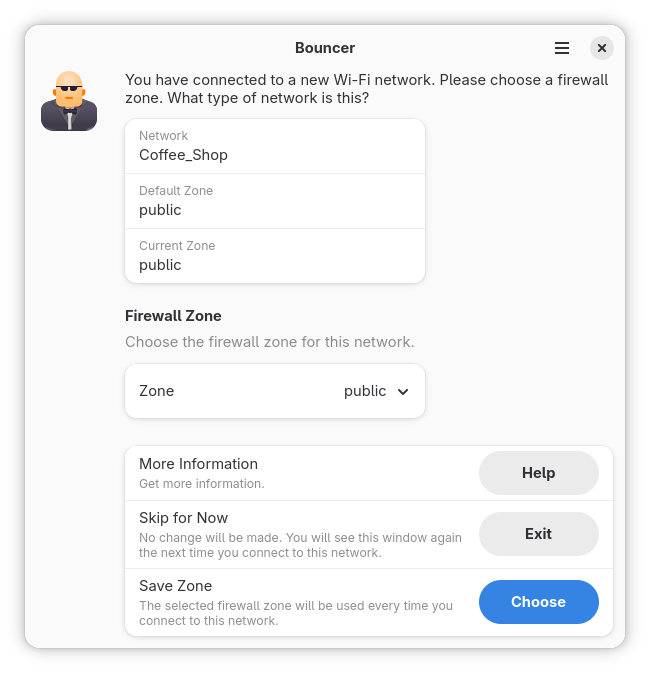

# Bouncer

Bouncer is an application to help you choose the correct firewall zone for wireless connections. When you connect to a new Wi-Fi network, Bouncer will open a window prompting you for what kind of network (e.g. home, public, work) it is. When you choose the network type, it is associated with that network and automatically used in the future.

[NetworkManager](https://networkmanager.dev/) and [firewalld](https://firewalld.org/) are required. If you don't use those, you can't use Bouncer. Fedora uses both by default. Other distributions may not.

Additional setup is required after installation. See the applicable section for your distribution.



## Installation

[](https://flathub.org/apps/io.github.justinrdonnelly.bouncer)

## Setup

Unlike most Flatpak applications, Bouncer needs to start when you log in. So autostart needs to be configured. Bouncer can do this for you once its dependencies and permissions are ready. Start it manually the first time and allow it to run in the background if prompted. After setup, it will start monitoring automatically when you log in. This must be done for each user on the system.

Starting Bouncer manually opens its dashboard. The Dependencies page shows whether the required components and permissions are ready. Once they are, click Monitor to begin monitoring in the current session. You can then close the dashboard without stopping monitoring.

If you want to enable autostart system-wide (i.e. for all users), you have to do that manually. With Bouncer installed system-wide, create `/etc/xdg/autostart/io.github.justinrdonnelly.bouncer.desktop` with the following contents (requires administrator privileges):

```ini
[Desktop Entry]
Type=Application
Name=Bouncer
Exec=flatpak run io.github.justinrdonnelly.bouncer --monitor
```

The `--monitor` option starts Wi-Fi monitoring in the background. Without it, Bouncer opens the dashboard.

Because Bouncer requires NetworkManager and firewalld, and changing firewall zones sometimes requires root (depending on polkit configuration), there may be additional setup required. The table below summarizes defaults for the listed desktop distribution versions; other versions and custom installations may differ. The polkit columns indicate whether active local users can modify system connections without an authentication prompt.

| Distribution | NetworkManager<br/>by default | firewalld<br/>by default | polkit OK for<br/>admin users<br/>by default | polkit OK for<br/>regular users<br/>by default |
| ------------ | ----------------------------- | ------------------------ | -------------------------------------------- | ---------------------------------------------- |
| Fedora 41    | &check;                       | &check;                  | &check;                                      | &check;                                        |
| Ubuntu 24.10 | &check;                       | &cross;                  | &check;                                      | &cross;                                        |
| Debian 12    | &check;                       | &cross;                  | &check;                                      | &check;\*                                      |

\* On Debian 12, the installer-created user belongs to `netdev` by default. Additional users may need to be added to this group; see the Debian section below.

### Fedora

For Fedora, everything just works! Just start Bouncer to confirm, and click the Monitor button to begin using Bouncer.

### Ubuntu

1. Uninstall ufw: `sudo apt remove ufw`
2. Install firewalld: `sudo apt install firewalld`
3. Regular users outside the `netdev` group need root to modify system connections. To allow a user to set the zone without authentication, add them to `netdev` (e.g. `sudo usermod -a -G netdev justin`), then log out and back in. Alternatively, you can create a custom polkit rule for the `org.freedesktop.NetworkManager.settings.modify.system` action (how to create custom polkit rules is beyond the scope of this document and is left as an exercise for the reader).
4. Start Bouncer and confirm your system is configured correctly. Then click the Monitor button to begin using Bouncer.

### Debian

1. Install firewalld: `sudo apt install firewalld`
2. Active local users in `sudo` or `netdev` can set the zone without authentication. As described in [Debian's NetworkManager documentation](https://wiki.debian.org/NetworkManager#Permissions), Debian 12's installer adds its first user to `netdev`, even if that user is not an administrator. Accounts created later with `adduser` do not automatically get this membership. If needed, add the user to `netdev` (e.g. `sudo usermod -a -G netdev justin`), then log out and back in. Alternatively, you can create a custom polkit rule for the `org.freedesktop.NetworkManager.settings.modify.system` action (how to create custom polkit rules is beyond the scope of this document and is left as an exercise for the reader).
3. Start Bouncer and confirm your system is configured correctly. Then click the Monitor button to begin using Bouncer.

## How It Works

Did you know that NetworkManager has a feature to automatically change your firewall zone based on the connection? This allows you to do things like block incoming ssh connections when you're using the coffee shop Wi-Fi. Unfortunately, this feature sits largely undiscovered. Bouncer brings GUI discoverability to it just when you need it - when you first connect to a new Wi-Fi network.

Bouncer integrates with NetworkManager and firewalld using [D-Bus](https://www.freedesktop.org/wiki/Software/dbus/). At a high level, it does the following:

1. Monitor Wi-Fi connections through NetworkManager's D-Bus API, including connections already active when monitoring starts.
2. If the connection has already been seen and configured, nothing happens. But if it hasn't, we continue.
3. Use D-Bus to ask firewalld for a list of zones. When the standard `home`, `public`, and `work` zones are available, the list is pared down to those zones plus the current and default zones. Otherwise, all zones are shown.
4. A window opens to explain what is happening, allowing the user to choose a firewall zone for the network.
5. If the user clicks Skip, or closes the window, no zone changes are made. Bouncer keeps monitoring and will prompt again the next time the user connects to that network. If the user selects a zone and clicks Choose, we continue.
6. Use D-Bus to set the connection zone in NetworkManager. After a successful update, Bouncer remembers the connection so it will not prompt for it again. NetworkManager will automatically change the firewall zone to this value on subsequent connections to this network.

The `[DEFAULT]` option uses firewalld's default zone rather than assigning a specific named zone. If the default zone changes later, connections using `[DEFAULT]` follow that change.

You can reopen Bouncer's dashboard at any time to manage saved zone choices on the Networks page. Select a network, choose a zone, and click Change to update it. Click Forget to have Bouncer prompt again the next time you connect to that network; this leaves its existing zone and NetworkManager connection profile unchanged. Both actions offer Undo.

## License

Bouncer is distributed under the terms of the Mozilla Public License, version 2.
